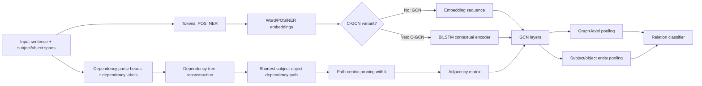
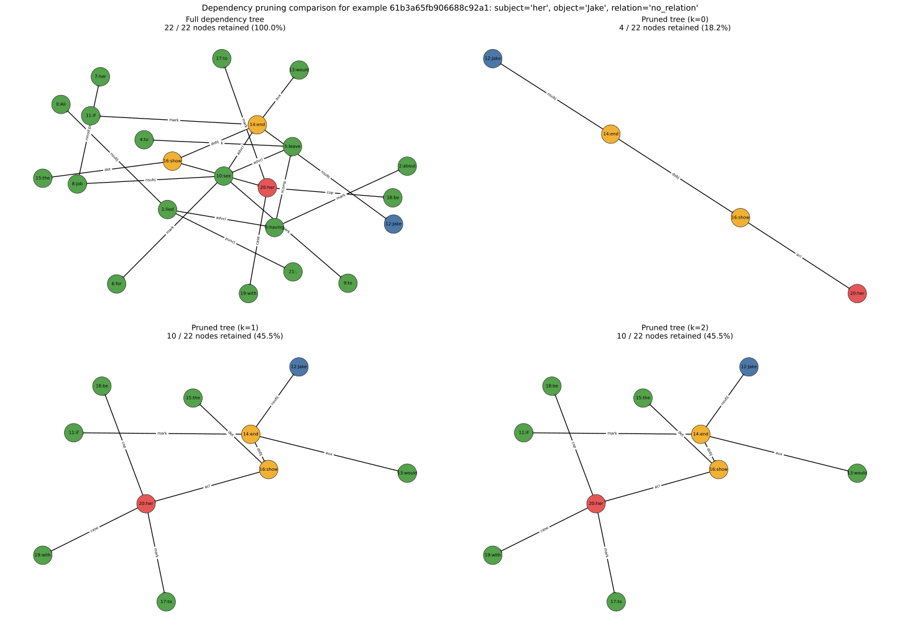

# Syntax-Aware Relation Extraction with Graph Convolutional Networks

**Exploring graph-based relation extraction through dependency-tree pruning, GCN/C-GCN architecture analysis, and lightweight reproducible experiments.**

Maintainer: **Nour Ghribi - AI & Data Science Engineering Student**  
GitHub: [Nour-Ghribi](https://github.com/Nour-Ghribi)

This repository is a professionalized, reproduction-oriented adaptation of the EMNLP 2018 work **Graph Convolution over Pruned Dependency Trees Improves Relation Extraction** by Zhang, Qi, and Manning. It preserves the original GCN/C-GCN research architecture while adding engineering improvements, reproducible CPU checks, dependency-pruning analysis, and technical documentation.

No model training, retraining, large dataset download, pretrained embedding download, or benchmark claim is included in this version.

## Project Overview

Relation extraction predicts the semantic relation between two marked entities in a sentence. For example:

> "John founded Acme in Paris."

With `John` as the subject and `Acme` as the object, a relation extraction system may predict a relation such as `org:founded_by`.

Syntax matters because the shortest grammatical path between the subject and object often removes irrelevant words while preserving the dependency structure that connects the entities. This project studies that idea with graph convolutional networks: a dependency parse is converted into a graph, optionally pruned around the subject-object dependency path, encoded by GCN layers, pooled at graph and entity levels, and classified into a relation label.

## My Engineering Contributions

These are the engineering contributions added around the inherited research implementation. They do not claim ownership of the original GCN/C-GCN model design.

1. **Modernized the original PyTorch research implementation.** Updated small Python 3 and modern PyTorch compatibility issues while preserving the original model flow.
2. **Corrected broken module imports.** The original code expected `data`, `model`, and `utils` packages that were not present in this flat repository layout; imports now match the actual source tree.
3. **Improved CPU-compatible execution paths.** Synthetic GCN and C-GCN forward-pass checks now run on CPU without requiring CUDA or trained weights.
4. **Added dependency tree pruning visualization.** `tools/visualize_dependency_pruning.py` reconstructs the dependency tree, identifies the subject-object path, applies the repository pruning logic, and saves SVG visualizations.
5. **Added comparative pruning analysis for `k=0`, `k=1`, and `k=2`.** The generated figure `assets/pruning_comparison.svg` compares the full dependency tree with progressively retained pruned graphs and reports retained-node counts.
6. **Added GCN vs. C-GCN structural inspection.** `tools/inspect_architectures.py` instantiates both variants, counts parameters, verifies CPU forward passes, and writes Markdown/JSON reports.
7. **Added synthetic forward-pass verification.** Tests verify output tensor shapes for both GCN and C-GCN without training or evaluating a model.
8. **Expanded automated testing.** The test suite covers pruning, shortest-path metadata, adjacency matrices, visualization generation, architecture inspection, and CPU execution.
9. **Rebuilt the technical README.** The documentation now clearly separates inherited research components from this repository's engineering extensions.

## Model Architecture



**GCN** uses word, POS, and NER embeddings as graph node features before graph convolution.  
**C-GCN** adds a BiLSTM encoder before the graph convolution layers, so each token representation is contextualized by sequence order before dependency-graph propagation.

The implemented classifier concatenates graph-level pooled features with subject-level and object-level pooled features, then applies an MLP and relation classifier.

## Dependency Pruning Explained

Path-centric pruning keeps the dependency path connecting the subject and object, plus optional nearby context.

- `k=0`: keep only nodes on the subject-object dependency path.
- `k=1`: keep path nodes and nodes one dependency edge away from the path.
- `k=2`: keep path nodes and nodes up to two dependency edges away.

The comparison below was generated from `train.json`, example index `0`.

- Example id: `61b3a65fb906688c92a1`
- Subject: `her`
- Object: `Jake`
- Gold relation in the sample: `no_relation`
- Shortest dependency path tokens: `Jake`, `end`, `show`, `her`



| Pruning distance | Retained nodes | Total nodes | Retained percentage | Retained tokens |
| --- | ---: | ---: | ---: | --- |
| `k=0` | 4 | 22 | 18.18% | `Jake`, `end`, `show`, `her` |
| `k=1` | 10 | 22 | 45.45% | `if`, `Jake`, `would`, `end`, `the`, `show`, `to`, `be`, `with`, `her` |
| `k=2` | 10 | 22 | 45.45% | `if`, `Jake`, `would`, `end`, `the`, `show`, `to`, `be`, `with`, `her` |

For this specific example, `k=2` retains the same nodes as `k=1` because there are no additional nodes at distance two from the retained path under the implemented pruning logic.

## GCN vs. C-GCN

The following table is generated by `tools/inspect_architectures.py` using synthetic CPU tensors. It is a structural comparison, not a performance benchmark.

| Architecture | BiLSTM | GCN layers | Hidden dim | Pooling | Parameters | CPU forward | Logits shape | Pooled shape |
| --- | --- | --- | --- | --- | --- | --- | --- | --- |
| GCN | False | 2 | 12 | max | 2581 | True | [2, 5] | [2, 12] |
| C-GCN | True | 2 | 12 | max | 4261 | True | [2, 5] | [2, 12] |

The GCN variant tests graph convolution over dependency-derived adjacency matrices directly from token-level embeddings. The C-GCN variant first applies a BiLSTM, which can encode sequential context before syntactic graph propagation. This repository verifies that both variants instantiate and execute on CPU, but it does not claim that one performs better than the other.

Reports are saved under:

- `reports/architecture_comparison.md`
- `reports/architecture_comparison.json`

## Experimental Validation

Executed validation is intentionally lightweight and reproducible:

- Unit tests for dependency tree construction and shortest-path metadata.
- Pruning checks for `k=0`, `k=1`, and `k=2`.
- Node-retention monotonicity checks as `k` increases.
- Adjacency matrix dimension and undirected symmetry checks.
- Synthetic GCN and C-GCN CPU forward-pass shape checks.
- Visualization output generation tests.
- Architecture inspection report generation.

Latest local result:

```bash
python -m pytest -q
# 12 passed in 14.00s
```

These checks validate code paths and architecture structure. They are not TACRED training runs and do not reproduce paper F1 scores.

## Repository Structure

```text
.
├── assets/
│   ├── dependency_pruning_k1.svg
│   └── pruning_comparison.svg
├── reports/
│   ├── architecture_comparison.json
│   └── architecture_comparison.md
├── tests/
│   ├── test_gcn_forward.py
│   ├── test_tree_pruning.py
│   └── test_visualizer.py
├── tools/
│   ├── inspect_architectures.py
│   └── visualize_dependency_pruning.py
├── gcn.py
├── tree.py
├── loader.py
├── trainer.py
├── train.py
├── eval.py
├── prepare_vocab.py
├── vocab.py
├── constant.py
├── torch_utils.py
├── scorer.py
├── train.json / dev.json / test.json
├── requirements.txt
├── LICENSE
└── README.md
```

## Getting Started

Create an environment and install dependencies:

```bash
python -m venv .venv
```

Windows PowerShell:

```powershell
.venv\Scripts\Activate.ps1
pip install -r requirements.txt
```

macOS/Linux:

```bash
source .venv/bin/activate
pip install -r requirements.txt
```

Run tests:

```bash
python -m pytest -q
```

Generate the pruning comparison:

```bash
python tools/visualize_dependency_pruning.py --input train.json --index 0 --comparison --output assets/pruning_comparison.svg
```

Generate the architecture inspection reports:

```bash
python tools/inspect_architectures.py
```

Generate a single pruning visualization:

```bash
python tools/visualize_dependency_pruning.py --input train.json --index 0 --k 1 --output assets/dependency_pruning_k1.svg
```

## Dataset and Training Notes

The original training and evaluation scripts expect TACRED-style JSON files with Stanford CoreNLP fields:

- `token`
- `stanford_pos`
- `stanford_ner`
- `stanford_head`
- `stanford_deprel`
- subject/object spans and entity types

Full TACRED is not included because it requires separate dataset access. GloVe vectors and trained checkpoints are also not included. The sample JSON files in this repository are suitable for inspection, tests, and visualization, not for reporting model quality.

## Technical Skills Demonstrated

- Python research code modernization
- PyTorch model inspection
- NLP relation extraction
- Graph Neural Networks and graph convolution
- Dependency parsing and shortest dependency paths
- Path-centric tree pruning
- BiLSTM and contextual sequence encoding
- Synthetic model forward-pass testing
- NetworkX/Matplotlib visualization
- pytest-based reproducibility checks
- Research attribution and technical documentation

## Limitations and Future Research

- No retraining or fine-tuning was performed.
- No TACRED benchmark score, F1 score, precision, recall, or accuracy is claimed.
- Full reproduction requires licensed TACRED data and external word embeddings.
- The architecture inspection uses synthetic tensors and validates structure, not predictive behavior.
- Future work could explore BERT or other transformer encoders combined with dependency GCNs.
- Future experiments could add controlled ablations for pruning distance, BiLSTM usage, pooling type, and dependency-edge directionality.

## GitHub Discoverability

Suggested repository description:

> Syntax-aware relation extraction with GCN/C-GCN, dependency-tree pruning analysis, architecture comparisons, and reproducible PyTorch tests.

Suggested topics:

`nlp`, `graph-neural-networks`, `gcn`, `relation-extraction`, `dependency-parsing`, `pytorch`, `bilstm`, `machine-learning`, `research-reproduction`

## Research Attribution

This project is based on the paper and original implementation for:

```bibtex
@inproceedings{zhang2018graph,
  author = {Zhang, Yuhao and Qi, Peng and Manning, Christopher D.},
  title = {Graph Convolution over Pruned Dependency Trees Improves Relation Extraction},
  booktitle = {Empirical Methods in Natural Language Processing (EMNLP)},
  year = {2018},
  url = {https://nlp.stanford.edu/pubs/zhang2018graph.pdf}
}
```

The original scientific architecture and paper attribution belong to Zhang, Qi, and Manning. This repository preserves the Apache License 2.0 license file and presents Nour Ghribi's engineering adaptations, tests, visual analysis tools, and documentation improvements around that research code.
