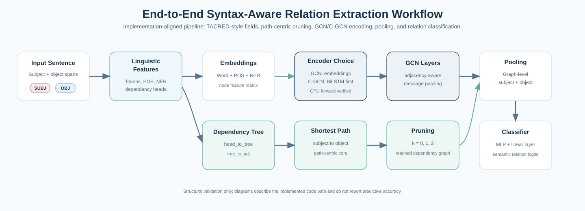
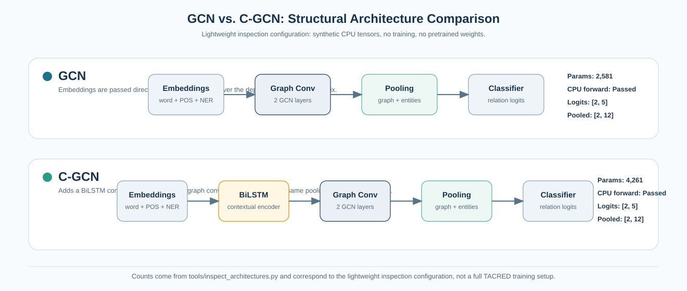
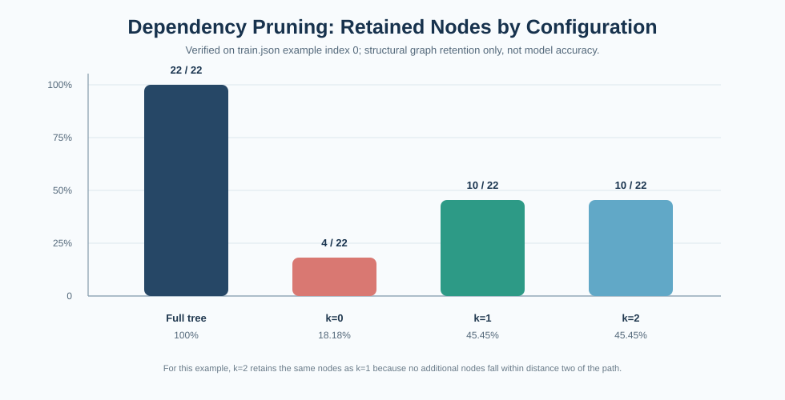

<div align="center">

# Syntax-Aware Relation Extraction with Graph Convolutional Networks

*Exploring GCN and C-GCN architectures through dependency-tree pruning, architecture analysis, and reproducible NLP experiments.*


**Maintainer and engineering contributor:** Nour Ghribi - AI & Data Science Engineering Student  
GitHub: [Nour-Ghribi](https://github.com/Nour-Ghribi)

</div>

---

## Navigation

[Project Overview](#project-overview) |
[My Contributions](#my-engineering-contributions) |
[Architecture](#architecture-workflow) |
[Pruning Analysis](#dependency-pruning-analysis) |
[GCN vs C-GCN](#gcn-vs-c-gcn-architecture) |
[Validation](#experimental-validation-dashboard) |
[Reproducibility](#reproducibility-workflow) |
[Attribution](#research-attribution)

---

## Portfolio Snapshot

| Area | Verified content |
| --- | --- |
| Automated tests | **12 passed** with `python -m pytest -q` |
| Architectures inspected | **2**: GCN and C-GCN |
| Pruning configurations | **4**: full tree, `k=0`, `k=1`, `k=2` |
| Generated figures | Workflow, GCN/C-GCN comparison, pruning comparison, retention chart |
| Reports | Markdown and JSON architecture inspection reports |
| Scientific scope | Structural validation only; no training or benchmark claims |

This repository is a professionalized, reproduction-oriented adaptation of **Graph Convolution over Pruned Dependency Trees Improves Relation Extraction** by Zhang, Qi, and Manning (EMNLP 2018). The original research architecture is preserved; the added work focuses on code modernization, visual analysis, reproducible checks, and clear technical documentation.

## Project Overview

Relation extraction predicts a semantic relation between two marked entities in a sentence.

Example:

> "John founded Acme in Paris."

If `John` is the subject and `Acme` is the object, a relation extraction model may predict a relation such as `org:founded_by`.

The core idea studied here is syntax-aware relation extraction. Instead of relying only on token order, the model uses dependency parsing to expose syntactic connections between words. The shortest dependency path between subject and object often contains the most relevant grammatical evidence. A graph convolutional network can then propagate information over this dependency graph and support relation classification.

This project does **not** claim new relation extraction state of the art. It demonstrates careful research engineering around an existing paper implementation.

## Architecture Workflow

The end-to-end workflow below matches the implemented code path: TACRED-style JSON inputs, linguistic features, dependency tree construction, path-centric pruning, GCN or C-GCN encoding, pooling, and classification.



## My Engineering Contributions

These contributions are Nour Ghribi's engineering extensions around the inherited research implementation. They do not present the original GCN/C-GCN model or path-centric pruning idea as new inventions.

| Contribution | Practical value |
| --- | --- |
| Modernized legacy PyTorch research code | Preserved the original model flow while making the code easier to inspect and execute in a recent Python environment. |
| Corrected imports and package assumptions | Fixed broken `data`, `model`, and `utils` imports caused by the repository's flat source layout. |
| Improved Python 3 compatibility | Replaced outdated Python 2 constructs and corrected small compatibility issues. |
| Added CPU-safe forward-pass checks | Verified that GCN and C-GCN can run synthetic forward passes without CUDA or trained weights. |
| Built syntax-aware pruning visualizations | Added tooling to reconstruct dependency graphs, identify subject-object paths, apply pruning, and save SVG figures. |
| Added pruning comparisons for `k=0`, `k=1`, and `k=2` | Made pruning behavior interpretable through retained-node counts and side-by-side graph views. |
| Added GCN vs. C-GCN inspection | Counted parameters and verified output tensor shapes for both variants under a lightweight inspection configuration. |
| Expanded automated testing | Added tests for pruning, adjacency matrices, visualization generation, CPU execution, and architecture reports. |
| Added reproducible reports and documentation | Generated `reports/architecture_comparison.md` and `.json`, then documented commands, outputs, limitations, and attribution. |

## Scientific Motivation

Long-range relations are often difficult for sequence-only models because relevant words can be far apart in surface order. Dependency trees can shorten the path between grammatically related tokens. In this project, the dependency structure is converted into an adjacency matrix and consumed by graph convolution layers.

Path-centric pruning controls how much syntactic context is retained around the subject-object dependency path:

- `k=0`: only the subject-object dependency path.
- `k=1`: the path plus one-hop context.
- `k=2`: the path plus up to two-hop context.

This makes the model's syntactic input more interpretable and reduces irrelevant graph context for a given entity pair.

## GCN vs C-GCN Architecture

The repository implements two architecture variants:

- **GCN:** word/POS/NER embeddings flow directly into graph convolution layers.
- **C-GCN:** a BiLSTM contextual encoder is applied before graph convolution.



The values below are generated by `tools/inspect_architectures.py` using a lightweight synthetic CPU configuration. They are structural inspection values, not full training-model benchmark numbers.

| Architecture | BiLSTM | Parameters | CPU Forward | Logits | Pooled |
| --- | --- | ---: | --- | --- | --- |
| GCN | No | 2,581 | Passed | `[2, 5]` | `[2, 12]` |
| C-GCN | Yes | 4,261 | Passed | `[2, 5]` | `[2, 12]` |

Generated reports:

- `reports/architecture_comparison.md`
- `reports/architecture_comparison.json`

## Dependency Pruning Analysis

The visual centerpiece of this repository is the dependency pruning comparison. It uses `train.json`, example index `0`, and applies the repository's actual path-centric pruning implementation.

Example metadata:

| Field | Value |
| --- | --- |
| Example id | `61b3a65fb906688c92a1` |
| Subject | `her` |
| Object | `Jake` |
| Sample relation label | `no_relation` |
| Shortest dependency path tokens | `Jake`, `end`, `show`, `her` |

### Full tree vs. pruned trees


### Retained-node chart



| Configuration | Retained Nodes | Total Nodes | Percentage |
| --- | ---: | ---: | ---: |
| Full tree | 22 | 22 | 100% |
| `k=0` | 4 | 22 | 18.18% |
| `k=1` | 10 | 22 | 45.45% |
| `k=2` | 10 | 22 | 45.45% |

This experiment measures structural node retention for one permitted sample example. It is **not** a model accuracy experiment and should not be extrapolated to the full TACRED dataset.

## Experimental Validation Dashboard

| Check | Latest verified result |
| --- | --- |
| Automated tests | `12 passed` |
| GCN CPU forward pass | Passed |
| C-GCN CPU forward pass | Passed |
| Synthetic logits shape | `[2, 5]` for both architectures |
| Synthetic pooled shape | `[2, 12]` for both architectures |
| Pruning configurations generated | Full tree, `k=0`, `k=1`, `k=2` |
| Architecture reports | Markdown and JSON generated |
| Predictive evaluation | Not run; no F1/precision/recall/accuracy claimed |

Latest test command:

```bash
python -m pytest -q
# 12 passed in 9.19s
```

## Reproducibility Workflow


### Quick start

```bash
git clone https://github.com/Nour-Ghribi/syntax-aware-relation-extraction-gcn.git
cd syntax-aware-relation-extraction-gcn
python -m venv .venv
```

Windows PowerShell:

```powershell
.venv\Scripts\Activate.ps1
pip install -r requirements.txt
```

macOS/Linux:

```bash
source .venv/bin/activate
pip install -r requirements.txt
```

Run the test suite:

```bash
python -m pytest -q
```

Generate the pruning comparison:

```bash
python tools/visualize_dependency_pruning.py --input train.json --index 0 --comparison --output assets/pruning_comparison.svg
```

Generate a single pruning view:

```bash
python tools/visualize_dependency_pruning.py --input train.json --index 0 --k 1 --output assets/dependency_pruning_k1.svg
```

Inspect GCN and C-GCN:

```bash
python tools/inspect_architectures.py
```

## Technical Stack

| Category | Tools and concepts |
| --- | --- |
| Programming | Python |
| Deep learning | PyTorch |
| NLP | relation extraction, dependency parsing, POS/NER features |
| Graph learning | graph convolution, adjacency matrices, syntactic graphs |
| Sequence modeling | BiLSTM in the C-GCN variant |
| Visualization | NetworkX, Matplotlib, SVG diagrams |
| Testing | pytest, synthetic CPU forward passes |
| Reproducibility | committed reports, generated assets, explicit commands |

## Repository Structure

```text
.
├── assets/
│   ├── dependency_pruning_k1.svg
│   ├── gcn_vs_cgcn_architecture.svg
│   ├── pruning_comparison.svg
│   ├── pruning_retention_chart.svg
│   └── relation_extraction_workflow.svg
├── reports/
│   ├── architecture_comparison.json
│   └── architecture_comparison.md
├── tests/
│   ├── test_gcn_forward.py
│   ├── test_tree_pruning.py
│   └── test_visualizer.py
├── tools/
│   ├── inspect_architectures.py
│   └── visualize_dependency_pruning.py
├── gcn.py
├── tree.py
├── loader.py
├── trainer.py
├── train.py
├── eval.py
├── prepare_vocab.py
├── vocab.py
├── constant.py
├── torch_utils.py
├── scorer.py
├── train.json / dev.json / test.json
├── requirements.txt
├── LICENSE
└── README.md
```

## Results and Interpretation

The verified outputs in this repository support three conclusions:

1. The dependency tree pruning implementation can be inspected visually and quantitatively for a sample TACRED-style example.
2. Both implemented architecture variants, GCN and C-GCN, can execute CPU-only synthetic forward passes and produce expected tensor shapes.
3. The project is suitable for research-code inspection and engineering demonstration, but it does not reproduce TACRED predictive performance because no training or full evaluation was run.

## Dataset and Model Notes

The original training and evaluation pipeline expects TACRED-style JSON with fields such as:

- `token`
- `stanford_pos`
- `stanford_ner`
- `stanford_head`
- `stanford_deprel`
- subject/object spans and entity types

Full TACRED is not included because it requires separate dataset access. GloVe vectors, pretrained weights, and checkpoints are also not included. The sample JSON files are used for lightweight inspection, tests, and visualization only.

## Limitations

- No model training or retraining was performed.
- No TACRED benchmark score is claimed.
- No F1, precision, recall, accuracy, or leaderboard-style metric is reported.
- Architecture inspection uses synthetic tensors and a lightweight configuration.
- The pruning retention chart describes one sample example and does not represent the whole dataset.
- Full scientific reproduction would require licensed data, embeddings, training, evaluation, and controlled experiment tracking.

## Future Extensions

- Add transformer encoders such as BERT before the dependency GCN.
- Compare directed vs. undirected dependency adjacency matrices.
- Add ablation studies for pruning distance, pooling type, BiLSTM usage, and number of GCN layers.
- Add edge-label-aware graph convolution.
- Package the project with a cleaner Python module layout while preserving research compatibility.

## Research Attribution

This repository builds on the paper and original implementation for:

```bibtex
@inproceedings{zhang2018graph,
  author = {Zhang, Yuhao and Qi, Peng and Manning, Christopher D.},
  title = {Graph Convolution over Pruned Dependency Trees Improves Relation Extraction},
  booktitle = {Empirical Methods in Natural Language Processing (EMNLP)},
  year = {2018},
  url = {https://nlp.stanford.edu/pubs/zhang2018graph.pdf}
}
```

The original scientific architecture, path-centric pruning idea, and paper attribution belong to Zhang, Qi, and Manning. Nour Ghribi's contributions in this repository are the modernization, analysis tooling, visualizations, tests, reports, and technical documentation around that research code.

## License

The original Apache License 2.0 file is preserved in `LICENSE`, including the required copyright notice.
