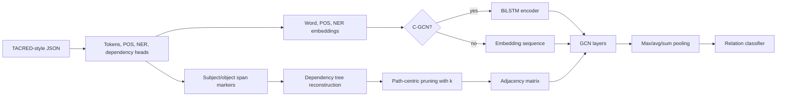

# Syntax-Aware Relation Extraction with GCNs

This repository is a reproduction-oriented study of **Graph Convolution over Pruned Dependency Trees for Relation Extraction**, based on Zhang, Qi, and Manning (EMNLP 2018). It keeps the original research architecture intact while adding lightweight modernization, clearer documentation, focused tests, and a dependency pruning visualization tool.

The goal is not to report new model scores. No training, retraining, TACRED download, GloVe download, or benchmark claim is included in this adaptation.

## Relation extraction example

Relation extraction predicts a semantic relation between two marked entities in a sentence:

> "John founded Acme in Paris."

Given `John` as the subject and `Acme` as the object, a model may predict a relation such as `org:founded_by`. This project studies a syntax-aware approach: instead of relying only on word order, it uses a dependency parse so the model can focus on the grammatical path connecting the two entities.

## Main ideas

- **Dependency parsing** represents a sentence as a graph of syntactic head-dependent edges.
- **Shortest dependency path** is the dependency path connecting the subject and object mentions.
- **Path-centric pruning** keeps nodes on that path and optionally nearby context. The pruning distance `k` means:
  - `k=0`: keep only nodes on the subject-object dependency path.
  - `k=1`: also keep nodes one dependency edge away from the path.
  - `k=2`: keep nodes up to two dependency edges away.
- **GCN** applies graph convolution over the pruned dependency graph.
- **C-GCN** adds a BiLSTM contextual encoder before the GCN layers.
- **Pooling and classification** combine sentence-level, subject-level, and object-level representations for relation classification.

## Architecture



## Repository structure

```text
.
├── gcn.py                         # GCN and C-GCN model modules
├── tree.py                        # Dependency tree construction and pruning logic
├── loader.py                      # TACRED-style JSON preprocessing and batching
├── trainer.py                     # Training/prediction wrapper
├── train.py / eval.py             # Original training and evaluation entry points
├── prepare_vocab.py / vocab.py    # Vocabulary and embedding preparation
├── tools/
│   └── visualize_dependency_pruning.py
├── tests/
│   ├── test_tree_pruning.py
│   ├── test_gcn_forward.py
│   └── test_visualizer.py
├── train.json / dev.json / test.json
└── requirements.txt
```

## Technologies

- Python 3
- PyTorch
- NumPy
- NetworkX and Matplotlib for dependency graph visualization
- pytest for lightweight tests

The original code was written for older PyTorch versions. This version includes small portability fixes, but full training compatibility on modern environments is not claimed unless you verify it locally with the required data and embeddings.

## Installation

```bash
python -m venv .venv
source .venv/bin/activate  # Windows PowerShell: .venv\Scripts\Activate.ps1
pip install -r requirements.txt
```

## Visualize dependency pruning

The visualizer runs on the small sample JSON files included in the repository and does not require model weights.

```bash
python tools/visualize_dependency_pruning.py --input train.json --index 0 --k 1 --output assets/dependency_pruning_k1.svg
```

Try different pruning distances:

```bash
python tools/visualize_dependency_pruning.py --k 0 --output assets/dependency_pruning_k0.svg
python tools/visualize_dependency_pruning.py --k 2 --output assets/dependency_pruning_k2.svg
```

The output highlights subject tokens, object tokens, shortest dependency path nodes, and retained context nodes.

## Run lightweight tests

```bash
pytest
```

The tests cover dependency tree construction, shortest-path metadata, pruning for different `k` values, adjacency matrix generation, a synthetic GCN forward pass, and visualization file generation. They do not train or evaluate a model.

## Dataset and model limitations

The training pipeline expects TACRED-style JSON with Stanford CoreNLP fields such as `stanford_head`, `stanford_deprel`, `stanford_pos`, and `stanford_ner`. Full TACRED requires a license and is not included here. GloVe embeddings and trained checkpoints are also not included.

The included `train.json`, `dev.json`, and `test.json` are small sample files suitable for code inspection and visualization only. They are not enough to reproduce paper results.

## What is original vs. adapted

Original implementation:

- GCN and C-GCN architecture for relation extraction.
- Dependency tree reconstruction and path-centric pruning.
- TACRED-style preprocessing, training, evaluation, and scoring scripts.

Adaptations in this repository:

- Fixed imports to match the actual flat source layout.
- Updated small Python 3 and PyTorch portability issues.
- Added `requirements.txt`.
- Added focused tests using synthetic/sample data.
- Added `tools/visualize_dependency_pruning.py`.
- Rewrote the README for research clarity and honest attribution.
- Expanded `.gitignore` for datasets, embeddings, checkpoints, and caches.

## Citation and attribution

This project is based on the paper and released code for:

```bibtex
@inproceedings{zhang2018graph,
  author = {Zhang, Yuhao and Qi, Peng and Manning, Christopher D.},
  title = {Graph Convolution over Pruned Dependency Trees Improves Relation Extraction},
  booktitle = {Empirical Methods in Natural Language Processing (EMNLP)},
  year = {2018},
  url = {https://nlp.stanford.edu/pubs/zhang2018graph.pdf}
}
```

License: Apache License 2.0, preserved from the original repository.
